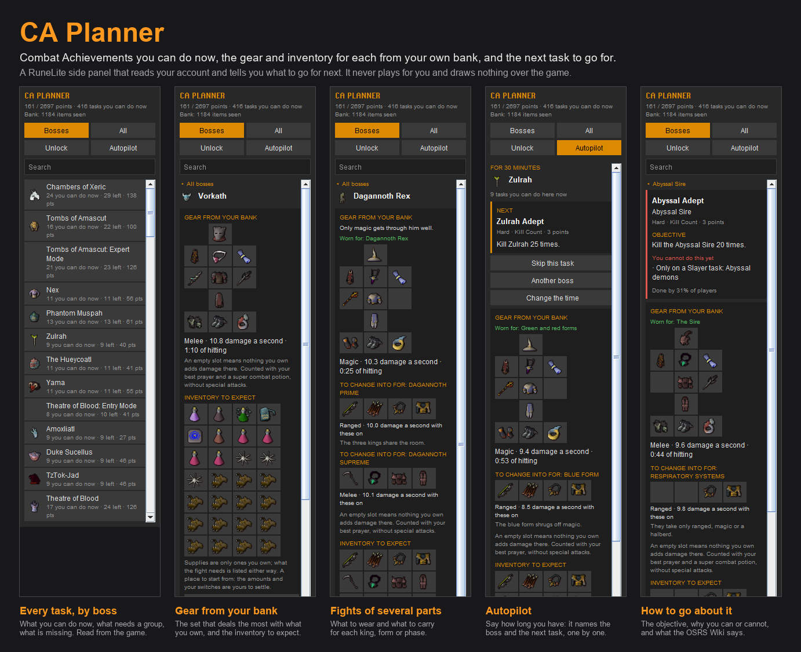

# CA Planner

A side panel for Combat Achievements: which tasks you can do now, the gear and inventory for each boss from your own bank, and the next task to go for.

It reads the tasks and what you have done from the game itself, so there is nothing to import or sync.

## What it shows

**Bosses.** Every boss with tasks left, with how many you can do now and how many points they are worth. Search by the boss's name or by what players call it ("bandos", "cg", "dks").

**All.** Every task, filtered by tier and type, the easier ones first (by the share of players who have done each, from the OSRS Wiki) or by points.

**Each task.** Its objective in the game's own words, whether you can do it now and, if not, what is missing: a quest, a level, a Slayer task, a group, an item the task asks for. Under it, how to go about the task as its page on the OSRS Wiki tells it, with a link to that page.

**Unlock.** What to do next to open the most tasks: the quest, level or item that the most pending tasks are waiting for.

**Autopilot.** Say how long you have (half an hour, an hour or two, longer). It names the boss worth the most in that time and the next task to try there, one after another, among those you can do now. It moves on when the game marks the task as done. You can skip a task, ask for another boss or change the time.

## Gear from your bank

For each boss the panel shows the set that deals the most damage among what you own, slot by slot, with the damage a second and the time the boss's health takes at that rate. Open your bank once so the plugin knows what you own; it remembers it per account.

- It only suggests what you can wear and use: the levels an item asks for, the runes you own for a spell, ammunition the weapon can fire, charges.
- What a fight makes you wear is in the set (a Slayer helmet or a facemask, an anti-dragon shield, boots of stone), and is listed in red when you do not own it.
- A task with a rule of its own gets its own set: one combat style only, a given weapon, no shield, a kind of spell.
- **Fights of several parts.** Where one set does not answer the whole fight, the panel says what to wear and what to carry for each part: the three Dagannoth Kings, Zulrah's forms, the Phantom Muspah, the Grotesque Guardians, the Royal Titans, the Moons of Peril, the Nightmare's totems, the Kalphite Queen's two forms, the Abyssal Sire's respiratory systems, the Tormented Demons, Yama's Judge. A task against the clock carries more pieces.
- Raids, the Gauntlet and fights that are not about damage get no set.

The figures use the standard accuracy and max hit formulas for melee, ranged and magic, with your best prayer and the potion of the style, and no special attacks. Weapons with a rule of their own are counted with it (demonbane and dragonbane weapons, the Scythe of vitur by the size of the monster, the Twisted bow, Tumeken's shadow, the keris partisans, crystal armour, Void, Inquisitor's, the Slayer helmet on task, the Salve amulet, ruby and diamond bolts, the elemental staves and tomes). A few get no figure and are said so: the Soulreaper axe, chinchompas and some others.

## Inventory to expect

Under the set, the inventory: what the fight cannot be done without (a key, a tool, a cure), then the usual supplies of the style, filled only with what you own. What the fight needs is listed even when you do not own it, in red.

- For the bosses the plugin has gone through one by one, the inventory is its own.
- For some others it is **provisional**, and says so: the amounts are those of the inventory on the boss's strategy page of the OSRS Wiki, filled with what you own.
- For the rest it says "under construction" rather than guess.
- What a task forbids is left out (no prayer restores for a task that forbids them), and deep in the Wilderness the usual teleport out is not suggested.

It is a place to start from: the amounts and your switches are yours to settle.

## Working with other plugins

All optional. The buttons that need a plugin you do not have say which one to install.

- **Shortest Path** or **GPS**: "Mark the way on the map" asks the route plugin for the way to the boss.
- **Inventory Setups**: the set and inventory are copied as text for its "Import setup", and the setup is opened in the bank. The panel lists the steps.

## Bug or suggestion

Every boss and task page has a "Bug or suggestion" button. It opens a window where you write what is wrong or what you would like; under your words it shows exactly what will be sent: the boss, the task, the set and inventory the planner gave, your combat levels and Slayer task. It never includes your name. Nothing is sent until you press a button:

- "Send the report" sends it to the author's Google Form.
- "Open the report on GitHub" opens a new issue with the text filled in, for you to post.
- "Copy the report" puts it on the clipboard.

Apart from that button, the plugin makes no network requests.

## Language

The "Language" setting shows the panel in English or in Portuguese (Brazil). Names of items, bosses and tasks stay as the game has them. In Portuguese, the tasks' objectives are this plugin's own translation, shown with the game's original text under them; the text from the wiki stays in English.

## What it never does

It draws nothing over the game: no overlay, no timer, no warning during a fight. It does not click, equip or change anything in the game. It tells you what to bring and what to go for; the fight is yours.

## Credits and licence

The code is under the BSD 2-Clause License. The text about how to go about each task is from the [Old School RuneScape Wiki](https://oldschool.runescape.wiki) and its contributors, under CC BY-NC-SA 3.0, in a file of its own; see `NOTICE.md`.
